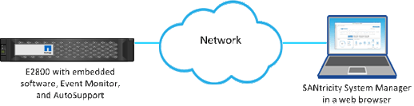

= Unified ManagerからSANtricity System Managerへのアクセスについて学ぶ
:allow-uri-read: 
:icons: font
:imagesdir: ../media/

[role="lead"]
1つ以上のストレージアレイを選択し、ストレージアレイを設定および管理する場合は、[起動]オプションを使用してSANtricity System Managerを開きます。

System Managerはコントローラに組み込みのアプリケーションで、イーサネット管理ポートを介してネットワークに接続されます。System Managerにはアレイベースの機能がすべて含まれています。

System Managerにアクセスするには、以下を準備しておく必要があります。

* ここに挙げられている配列モデルの一つ：link:https://docs.netapp.com/us-en/e-series/getting-started/learn-hardware-concept.html["Eシリーズハードウェアの概要"^]
* Webブラウザを使用したネットワーク管理クライアントへのアウトオブバンド接続

